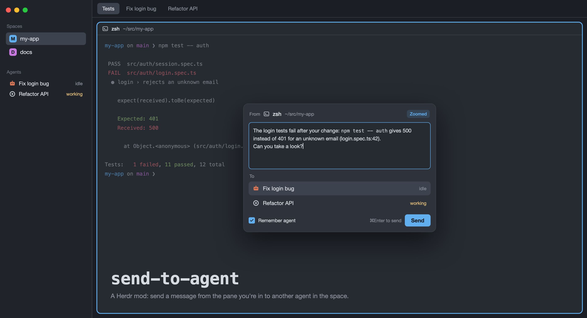

# herdr-send-to-agent

A Herdr mod: from the pane you're in, write a message and send it to another
agent in the same space.



Herdr has no way to type into another pane without going there. `hc send`
does it from a shell, but you need the agent's address and a quoted string.
This mod opens a window over the pane you're in, lists the agents of the
space to pick from, and sends with `hc send` for you, so the message reaches
the agent as if typed.

The window, opened with a key of your own:

- **From**: the pane you're in. It is zoomed while the window is open, so
  there's no mistaking which pane you send from, and a `Zoomed` badge says
  so.
- **Message**: multi-line (Enter is a new line), pre-filled with a default
  for the program in that pane if you set one.
- **To**: the other agents in the space, with their status.
- **Remember agent**: on by default; the same agent is picked the next time
  you send from this pane.
- **Send**, or Cmd+Enter. Esc closes the window.

It doesn't touch your layout or your pane headers, so it works next to any
other mod.

## Install

```sh
git clone https://github.com/nao23/herdr-send-to-agent
cp -r herdr-send-to-agent/mods/send-to-agent ~/.config/herdr-app/mods/
```

Keep the folder's name: the mod finds its files under
`mods/send-to-agent/`. It has no place in a layout (`"place": "none"`), so
nothing appears until you open it. Bind a key to it in your own
`~/.config/herdr-app/keys.json`:

```json
{
  "global": {
    "cmd-shift-s": "mod.open:send-to-agent"
  }
}
```

No key is bound for you. Herdr's own shortcuts are in the same file, so you
can see what is already taken before choosing.

## Config

Settings live in `config.json` in the mod's folder. Copy
`config.example.json` to `config.json` and edit it; without a `config.json`,
the example is used. It is read each time the window opens.

```json
{
  "default-messages": {
    "<program key>": "Message, with {repo} and {cwd} filled in"
  }
}
```

| Key | Does |
| --- | --- |
| `default-messages` | Pre-fills the message when the window opens from a pane running that program |

- A program key is the program's key in Herdr's program table, as
  `~/.config/herdr-app/programs.json` names it. A program missing from the
  table can be added there.
- `{repo}` is the git root of the source pane's folder (the folder itself
  outside a repository), `{cwd}` the folder.

## Example: hand a hunk review back to the agent

Review an agent's diff in [hunk](https://hunk.dev), leave comments, then tell
the agent to read them — from the hunk pane, with one key.

1. Make hunk a known program in `~/.config/herdr-app/programs.json`, so a
   pane running it has the key `hunk`:

   ```json
   { "programs": { "hunk": { "name": "Hunk" } } }
   ```

2. Give it a default message in `config.json` (this is what
   `config.example.json` ships):

   ```json
   {
     "default-messages": {
       "hunk": "I left review comments in hunk. Read them with `hunk session comment list --repo {repo} --type user --json` and address them."
     }
   }
   ```

3. In the hunk pane, press your key: the message is already written, with
   `{repo}` replaced. Pick the agent and press Cmd+Enter.

## Uninstall

1. Remove the key you bound from `keys.json`.
2. Delete `~/.config/herdr-app/mods/send-to-agent`.
3. Delete `"send-to-agent"` from `~/.config/herdr-app/seen.json`.
4. Delete `~/.config/herdr-app/data/send-to-agent`.
5. Optionally, delete the `send-to-agent.window` and `send-to-agent.last`
   keys from `~/.config/herdr-app/shared.json`: the open window and the
   remembered agents.

## Build it yourself

`RECIPE.md` is the brief this mod was built from: hand it to an agent with an
empty folder and it builds the same thing, with the traps written down. Use it
if these files do not work on your version of Herdr, or if you want it
different.

## Tested with

herdr-app 0.1.16, herdr-core 0.1.21, macOS.

Uses `panes()`, `agents()`, `spaces()`, `focused()`, `theme()`, `home()`,
`props()`, `shared()` / `setShared()`, `readTextFile()`, `exec("git")`,
`hc(["send"])`, `notify()`, `closeOverlay()` and `run("pane.zoom")`. No
network.

## License

MIT. The check mark icon is from [Lucide](https://lucide.dev) (ISC).
