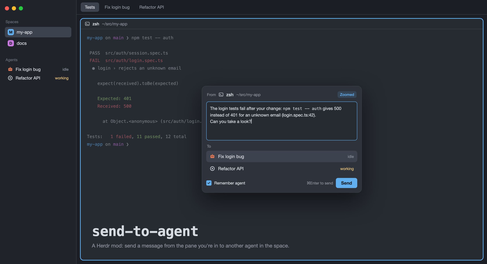

# Send to agent

From the focused pane, write a message and send it to another agent in the
same space. The mod opens as a window in the middle of Herdr, from a key the
person binds to `mod.open:send-to-agent`. It shows which pane it sends from,
a multi-line message (pre-filled with a per-program default), the space's
other agents to pick one, and Send. It sends with `hc send`, so the message
reaches the agent as if typed.

## What you see

- A window 420px wide in the middle of Herdr, in the theme's `popover`
  color, 10px padding, 12.5px text. Nothing behind it is dimmed.
- **From** row (22px): `From` in `dim` 11px, the source program's icon, its
  name in `foreground` (medium weight, at most 200px, truncated), its folder
  in `dim` (`~` for home). When the window zoomed the pane, a `Zoomed` badge
  at the right end: 10.5px `accent` text on `accent` at 15% opacity, 18px
  tall, rounded.
- **Message**: a textarea, 5 rows, placeholder `Message`.
- **To** label (22px, `dim` 11px), then the agents: rows 31px tall, 2px
  apart, rounded, each with the program icon, a label (truncated) and the
  status word in that status's theme color. The picked row has `selected`
  as its background; any row `hover` on hover. At most 6 rows show, the rest
  scroll. With none: `No other agents in this space` in `muted`.
- **Footer** (30px): a `Remember agent` checkbox (a 14px box: `accent`
  filled with a check mark when on, `dim` outline when off), `⌘Enter to
  send` in `dim` 11px aligned right, and a `Send` button (28px, rounded):
  `solid` / `solid_foreground` when there's an agent and text, `raised` /
  `dim` otherwise.

## How it behaves

- The source is the focused pane when the window opens. If it isn't zoomed
  and can be (`movable`), the window zooms it, and unzooms it when it
  closes — only if it is still zoomed.
- The message starts empty and is filled with the source program's default
  once it is read, unless the person already typed something.
- Defaults come from `config.json` in the mod's folder, else the shipped
  `config.example.json`: `{ "default-messages": { "<program key>": "..." } }`,
  keyed by `pane.program.key`. `{repo}` is replaced with
  `git rev-parse --show-toplevel` run in the pane's folder (on the space's
  machine; the folder itself when that fails) and `{cwd}` with the folder.
  Invalid JSON gives a warning notification and no default.
- Targets are `agents()` in the source's space, without the source's own
  terminal. A label is the tab's name if the person named the tab, else the
  terminal's title.
- The picked agent is the one clicked, else the one this pane last sent to,
  else the first.
- Enter is a new line. Cmd+Enter or Send sends when there's an agent and
  non-blank text: the window closes, `hc send <address> <text>` runs, and a
  notification says `Sent to <label>` (success, 3s) or shows `hc`'s error.
- Remember agent starts on, unless this pane last sent with it off. Sending
  records `{ <source terminal>: <agent address> }` (or `null` when off) and
  drops entries of terminals no longer in `panes()`.
- Esc closes the window. Switching tabs closes it. Opening it again while
  one is open replaces the open one (and keeps its zoom).

## Built from

- `mods/send-to-agent/mod.json`: `{ "place": "none", "title": "Send to
  agent", "overlay": { "kind": "window", "width": 420 } }`. `mod.open`
  uses this overlay spec.
- `mods/send-to-agent/main.js`: one `View` subclass.
  - `init` takes `props().overlay`, finds the source in `panes()` by
    `focused().pane`, its space in `spaces()` by tab, zooms it, records
    `shared("send-to-agent.window") = { overlay, zoomed }`, creates the
    `TextareaState` and focuses it, and spawns the default-message read.
  - `close()` unzooms and clears the window record.
  - `render` closes the window when `focused().tab` changed, and draws it.
- `mods/send-to-agent/config.example.json`: an example default, for hunk
  (the README's example).
- `mods/send-to-agent/check.svg`: Lucide's `check`, stroke 3.
- `herdr`: `panes`, `agents`, `spaces`, `focused`, `props`, `theme`, `home`,
  `shared`, `setShared`, `readTextFile`, `appHome`, `exec`, `hc`, `notify`,
  `closeOverlay`, `run`. App commands: `pane.zoom`.
- `gpui-kit`: `View`, `div`, `svg`, `image`. `gpui-base`: `h_flex`,
  `v_flex`, `TextareaState`, `Textarea`, `Checkbox`.
- Stored state: `shared("send-to-agent.window")` and
  `shared("send-to-agent.last")`.

## Watch out

- Use `"kind": "window"`, not `dialog` or `popup`. A dialog dims the whole
  window, the source pane included. A popup opens at the pointer, which may
  be over any pane. A window opens centered and dims nothing, but Herdr
  closes it neither on Esc (Esc goes to the mod) nor on a click beside it,
  and drags it by any press the mod doesn't stop: handle `escape` in
  `on_key_down`, and stop `on_mouse_down` on the root.
- A window stays until closed, so opening another stacks them: close the
  one recorded in shared state.
- An overlay sizes to its content. Give the root an explicit height, or a
  `flex_1` list lays out at zero.
- The textarea emits `submit` on plain Enter too. Send only when the event's
  `secondary` (Cmd) is set, or Enter sends instead of starting a new line.
- Read `props()` in `init`, not after an `await`: by then it may answer for
  another copy.
- There is no API for a pane's position or size, nor for the window's, so
  the window can't sit over the source pane. Zooming is what marks it.
- Don't call `layout.set` to change a frame for a while (a thicker focus
  frame, say). It writes the live layout into `layouts/<name>.json`, folding
  in the theme pick and resized widths kept in `layouts/.state/`.
- `shared()` is saved to disk and outlives the app: a window open when the
  app quit is still recorded on the next start.
- Mods are found by folder name: `svg("mods/send-to-agent/check.svg")` and
  `appHome()/mods/send-to-agent/...` break if the folder is renamed.

## Done when

- `herdr-app check mods/send-to-agent` passes.
- With a key bound, in a tab split into two panes, the key opens the window
  centered, the focused pane zoomed, `From` naming it with `Zoomed`.
- Enter adds a line; Cmd+Enter sends to the picked agent, which receives the
  text; the pane is unzoomed afterwards.
- Esc and switching tabs close the window and unzoom.
- With a `config.json` default for the source program, the message is
  pre-filled with `{repo}` replaced.
- After sending to the second agent with Remember agent on, reopening from
  the same pane picks it; after sending with it off, it starts off.
